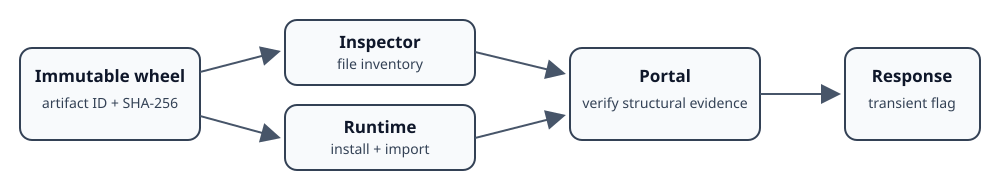

# Schrödinger Package

**Category:** web  **Difficulty:** hard  **Author:** abu

> Astra Package Exchange is the internal service engineering teams use to register, inspect, and run Python packages before they're cleared for wider use.
>
> Make the service hand you the flag.

Three roles off one image: a public portal (holds the flag), and internal inspector and runtime services. Runtime imports uploaded code in a seccomp + rlimit sandbox and never sees the flag; `challenge/ISOLATION.md` describes that boundary and is checked by the tests.

```
cd challenge && docker compose up --build --wait     # portal on :8080, dummy flag from flag.txt
python -m pytest tests                                # unit tests
```

## Solution

The service takes wheels, gives each upload an ID, and has separate actions for inspection and for a runtime session. The inspector report lists every file with its SHA-256. A runtime session reports the installed module path and its SHA-256 too. So both stages work from the same upload, and we can compare what each one actually looked at.



Baseline with a normal wheel for a package `schrodinger-probe` (module `schrodinger_probe/__init__.py`):

```sh
BASE=http://127.0.0.1:8080
ID=$(curl -s -F 'file=@ordinary.whl' "$BASE/api/packages" | jq -r .package_id)
curl -s -X POST "$BASE/api/packages/$ID/inspection" | jq '{status, summary}'
curl -s "$BASE/api/packages/$ID/inspector" | jq '.inspection.files[] | select(.path == "schrodinger_probe/__init__.py")'
curl -s -X POST "$BASE/api/packages/$ID/runtime" | jq '{status, output, flag}'
```

Inspector and runtime hashes match, and the artifact hash stays the same from upload to install. So nobody is swapping the file; if there's a gap, it's in how each stage reads the archive.

ZIP lets you have two entries with the same name. We built a wheel with two `schrodinger_probe/__init__.py` members with different bodies. The inspector showed one row for that path, hashed as the first body. Runtime reported the same path, hashed as the second. Same artifact, different member picked.

That's the bug. The inspector groups members by path and keeps the first one. pip (25.0.1 on Python 3.12.14, both pinned in the image) extracts in order, so the last one wins on disk. Order matters: first module, then the normal metadata and `RECORD`, then the second module. `RECORD` has to describe the final bytes or pip refuses. Duplicate metadata paths are rejected by inspection, so it only works on the module itself.

The portal doesn't just hand out the flag for differing hashes. It checks that upload, inspection and runtime all refer to the same artifact, that the module installed and imported successfully, that there really are multiple occurrences of the path, and that the inspector's digest differs from the installed one. Identical duplicates, a single malicious entry or a failed import don't count. The flag only comes back in the immediate runtime response, not in saved output or logs.

```
python solution/solve.py --base-url http://127.0.0.1:8080
```

Flag is dynamic per instance (`H7CTF{dummy}` locally).
