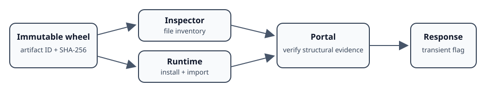

# Schrödinger Package

## Recon

I started with the web app and its API reference. The service accepts Python
wheels, assigns each upload a package ID, and exposes separate operations for
inspection and runtime sessions. The Inspector report includes the wheel's
file inventory and SHA-256 values. Runtime sessions show their status, output,
installed module path, and installed module SHA-256.

That gave me a useful comparison point: both operations work from the same
registered package, so I could compare what the Inspector recorded with what
Runtime installed.



## Establishing a baseline

I uploaded an ordinary wheel, then requested an inspection and a runtime
session. For a package named `schrodinger-probe`, the import module path is
`schrodinger_probe/__init__.py`.

```sh
BASE=http://127.0.0.1:8080
curl -s -F 'file=@ordinary.whl' "$BASE/api/packages" > upload.json
ID=$(jq -r .package_id upload.json)

curl -s -X POST "$BASE/api/packages/$ID/inspection" | jq '{status, summary}'
curl -s "$BASE/api/packages/$ID/inspector" \
  | jq '.inspection.files[] | select(.path == "schrodinger_probe/__init__.py")'
curl -s -X POST "$BASE/api/packages/$ID/runtime" \
  | jq '{status, output, flag}'
```

With one module entry, the Inspector's module SHA-256 and Runtime's installed
module SHA-256 matched. The wheel's overall SHA-256 also stayed the same from
upload through installation. That ruled out an upload replacement and pointed
to how each stage reads the archive.

## Comparing the two views

ZIP archives can contain more than one file entry with the same name. I tested
that property with a wheel containing two entries for
`schrodinger_probe/__init__.py`, while keeping its metadata and other files
ordinary. The package itself remains valid Python, and the final module can
import successfully.

The Inspector report showed one row for that path. Its SHA-256 matched the
first module body I had written to the archive. Runtime reported the same
module path, but its installed SHA-256 matched the second body. The artifact
SHA-256 still matched the original upload, so the difference was in archive
member selection, not a changed artifact.

That was the key observation: the Inspector and the installer were consuming
different occurrences of one archive path.

## Why it works

Inspector groups archive members by path and records the first occurrence of
the package's import module. The Runtime resolver identifies the last
occurrence, then pip installs the wheel. The challenge image pins Python
3.12.14 and pip 25.0.1, where installation of this wheel leaves the last
module body on disk.

The order matters. The wheel contains the first module, its normal wheel
metadata and `RECORD`, then the second module with the same path. `RECORD`
describes the final module bytes so pip accepts the installation. Other
duplicate paths, including wheel metadata records, are rejected by inspection.

## Building and submitting the wheel

The reference solver builds this wheel and performs the same three API calls:

```sh
python solution/solve.py --base-url http://127.0.0.1:8080
```

In the solver, the first `schrodinger_probe/__init__.py` contains a harmless
module body. A second entry uses the same path and contains different bytes.
The final body is valid Python and prints a short line during import. This
makes the evidence easy to distinguish from a failed install or import.

## Portal verification

Different hashes alone are not enough. Portal checks that the upload and
inspection refer to the same artifact, that Runtime used those same bytes,
and that the expected package module was installed and imported successfully.
It also requires multiple archive occurrences and matching Runtime-selected
and installed digests. Finally, it compares that digest with Inspector's
record for the same module path.

The flag is returned in the immediate runtime response only when those checks
show a real digest difference. Identical duplicate entries, one malicious
entry, a failed import, or package-controlled output do not satisfy the check.
The local development instance prints `H7CTF{dummy}`; the deployed instance
uses its configured flag.
