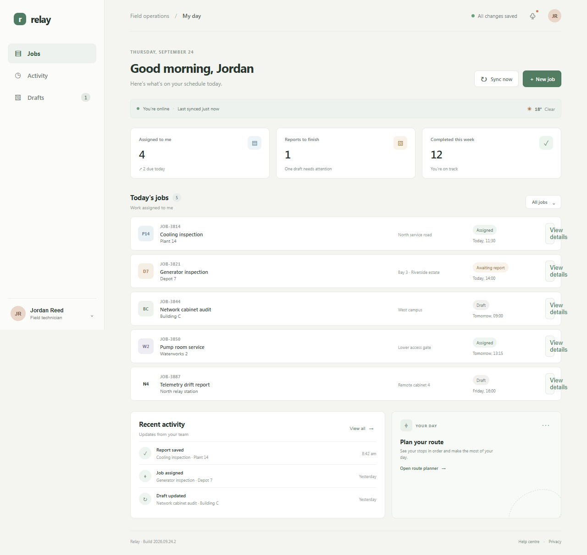

# ZOMBIE WORKER

**Category:** web  **Difficulty:** hard  **Author:** abu

> Relay keeps field technicians working through unreliable connections. Jobs,
> drafts, and reports continue syncing while a routine client update rolls out.

Handout: `handout/README.md` and `handout/hints.md`. Two services: the public Relay PWA and a private exporter with no port and no egress. Two dynamic flags: `CHECKPOINT_FLAG` (Relay) and `EXPORT_FLAG` (exporter only). There is no admin bot; the player's own Chromium does the whole service worker dance. Needs HTTPS in production (localhost counts as secure for local testing).

```
export FLAG='H7CTF{dummy}' EXPORTER_TOKEN=$(python3 -c 'import secrets; print(secrets.token_hex(32))')
docker compose -f challenge/docker-compose.yml up --build
```

Tests (Playwright + Chromium) are in `challenge/tests/`; install `requirements.txt` and `requirements-test.txt`, then `python -m playwright install chromium`.



## Solution

A fresh session starts on v1. Leave the page open and let `/sw-2026.09.24.1.js` install and take control before touching anything. On first run it makes a P-256 keypair (private key non-extractable, stored in IndexedDB) and registers only the public key. On JOB-3887 the v1 form lets you save a report package setting. Save it here, before the update, because the v1 API still accepts the old `complete` profile even though the dropdown only shows summary and record.

**Sync now** moves the session to v2 and reloads the page. v2 registers `/sw-2026.09.24.2.js`, but the old page is still controlled by the legacy worker, so the new one installs and sits in waiting. Neither worker calls `skipWaiting()`, and v2 never calls `clients.claim()`. Check it in the console:

```js
const r = await navigator.serviceWorker.getRegistration("/");
[r.active?.scriptURL, r.waiting?.scriptURL, navigator.serviceWorker.controller?.scriptURL];
```

Don't close that tab. Once the old client goes away, v2 activates and the bug goes with it.

The v1 release manifest points at `/assets/contracts/report-package-v1.json`, which lists what each old package profile contains. `complete` includes the commissioning material. v2 only exposes `scope=summary|record` and its API rejects the old `profile` field, so the old setting can't be set anymore, only kept.

In v2, set JOB-3887's report detail to **Field record**, wait for that revision to appear in the dispatch snapshot, and hit **Sync now**. v2 returns a preview plan with `persist=false`. The v2 worker would drop it. The old worker is still in charge, so its legacy adapter reads the saved v1 preference from IndexedDB, turns the plan into a v1 complete-package operation, writes it to its outbox and stages it with `/api/sync/outbox`. Relay recomputes the expected conversion, and if it matches it returns a dispatch reconciliation receipt. That receipt is the first flag (`CHECKPOINT_FLAG`).

Staging alone publishes nothing. **Send queued updates** sends `RELAY_OUTBOX_FLUSH` to the controller over MessageChannel, the legacy worker signs the operation with its stored key and replays it once to `/api/sync/replay`. JOB-3887 is now published as a v1 complete package.

Finally, **Prepare report package** on JOB-3887 and download the zip. The exporter writes the second flag into `attachments/commissioning-note.txt` because the package is the historical complete one.

```
python solution/solve.py --url https://<instance-host>
```

You can also skip the browser and emulate the whole protocol with your own P-256 key. The server can't tell where a key was generated, so this is accepted on purpose, but the envelope has to match the legacy conversion exactly (plan, snapshot revision and digest, v1 preference, expiry, staging, one-use replay). If you rolled forward with the wrong setting, start a fresh session.

Flags are dynamic, two per instance.
